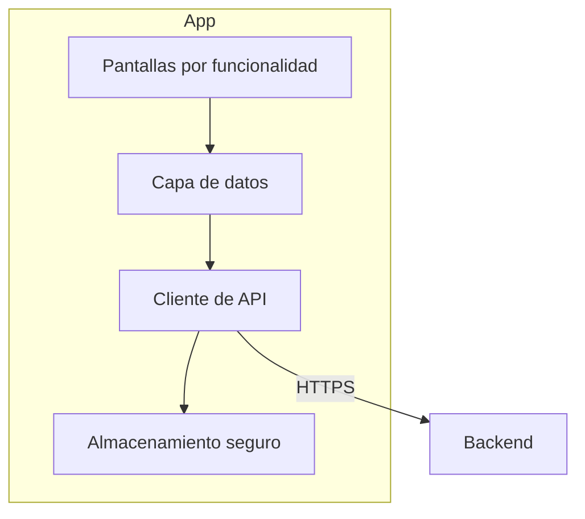

# Planner Mobile

App móvil de [Planner For Education](https://github.com/Jeisondls/planner-for-education), hecha con React Native y Expo. Permite al docente crear y generar planificaciones, instrumentos de evaluación y materiales desde el teléfono.

> Código fuente privado (producto comercial). Este documento explica el enfoque de diseño; no describe la configuración, las versiones ni los procesos de compilación del producto.

## Problemas y enfoque

| Problema | Enfoque |
|---|---|
| Una generación con IA puede tardar y la conexión móvil es inestable | El servidor responde de inmediato y procesa en segundo plano; la app consulta el estado del trabajo |
| La sesión caduca en medio del uso | Cliente de API que renueva la sesión de forma automática y la cierra si el servidor la invalida |
| Los docentes olvidan contraseñas y reutilizan claves | Inicio de sesión con proveedores externos y métodos adicionales, además de la contraseña |
| Cobrar suscripciones dentro de la app sin saltarse la tienda | Facturación de la tienda de aplicaciones, verificada siempre en el servidor |
| Publicar correcciones rápido | Actualizaciones remotas y mecanismo para exigir una versión mínima |
| Datos del servidor repetidos y desactualizados en pantalla | TanStack Query para caché, reintentos e invalidación |

## Arquitectura

## Funcionalidades

Planificaciones · Situaciones de aprendizaje · Instrumentos y pruebas · Materiales · Asistencia · Cuenta y suscripción

## Decisiones técnicas

- **Rutas por archivos** con Expo Router y una carpeta por funcionalidad.
- **Capa de autenticación separada** del resto de la app, con un único contexto de sesión.
- **Tiempos de espera distintos** para peticiones normales y para tareas largas.

## Tecnologías

React Native · Expo · TypeScript · TanStack Query

## Relacionado

[Proyecto](https://github.com/Jeisondls/planner-for-education) · [Versión web](https://github.com/Jeisondls/planner-web) · [Backend](https://github.com/Jeisondls/planner-odoo-backend)
