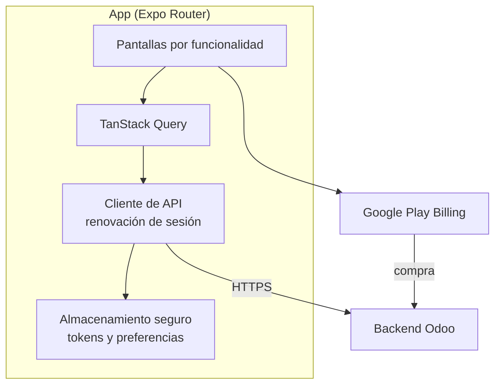

# Planner Mobile

App móvil de [Planner For Education](https://github.com/Jeisondls/planner-for-education), hecha con React Native y Expo. Permite al docente crear y generar planificaciones, instrumentos de evaluación y materiales desde el teléfono.

> Código fuente privado (producto comercial). Este documento explica el diseño y las decisiones técnicas.

## Estado

Versión 1.5.9 · Android · Más de 300 archivos TypeScript organizados por funcionalidad.

## Problemas y soluciones

| Problema | Solución aplicada |
|---|---|
| Una generación con IA puede tardar minutos y la conexión móvil es inestable | El servidor responde de inmediato y procesa en cola. La app consulta el estado (en cola, generando, listo, error) y tiene un tiempo de espera mayor solo para generar |
| Los tokens de sesión caducan en medio del uso | Cliente de API que renueva la sesión de forma automática, evita renovaciones duplicadas si varias peticiones fallan a la vez y cierra la sesión si el servidor la invalida |
| Los docentes olvidan contraseñas y reutilizan claves | Inicio de sesión con Google y Microsoft, passkeys, biometría del dispositivo y verificación en dos pasos |
| Cobrar suscripciones dentro de la app sin saltarse la tienda | Google Play Billing con `expo-iap`; el servidor verifica cada compra y activa la licencia |
| Publicar correcciones rápido sin esperar la revisión de la tienda | Actualizaciones OTA con perfiles de producción y vista previa, y una pantalla que exige actualizar cuando una versión queda obsoleta |
| Datos del servidor repetidos y desactualizados en pantalla | TanStack Query para caché, reintentos e invalidación |

## Arquitectura

## Funcionalidades

Planificaciones diarias y de unidad · Situaciones de aprendizaje · Instrumentos y pruebas escritas · Materiales · Asistencia · Quiz · Asistente por voz · Catálogos curriculares · Cuenta, plan y suscripción · Referidos · Calificación de la app

## Decisiones técnicas

- **Rutas por archivos** con Expo Router, y una carpeta por funcionalidad en `features/`.
- **Capa de autenticación separada** del resto: Google, Microsoft, contraseña, passkey y biometría comparten un mismo contexto de sesión.
- **Tiempos de espera distintos** para peticiones normales y para generación con IA.
- **Endurecimiento del build de Android** mediante un plugin propio de Expo.
- **Scripts de compilación** para APK de prueba, Play Store y canal alfa.

## Tecnologías

React Native 0.86 · React 19 · Expo · Expo Router · TypeScript · TanStack Query · expo-iap (Google Play Billing) · Google Sign-In · autenticación biométrica

## Relacionado

[Versión web](https://github.com/Jeisondls/planner-web) · [Backend Odoo](https://github.com/Jeisondls/planner-odoo-backend) · [Infraestructura](https://github.com/Jeisondls/planner-docker-infra)
